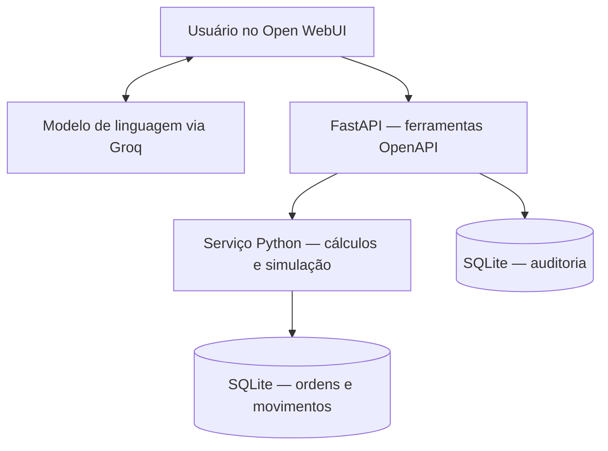

# Agente de IA para balanço de massa

Projeto acadêmico desenvolvido por **Alef Henrique de Souza Nascimento** para analisar o balanço de massa de ordens de produção e simular realocações de consumo. A solução reúne uma interface de IA em linguagem natural, uma API Python e uma base SQLite.

**Todos os dados são fictícios.** O sistema apresenta análises e simulações, sem executar lançamentos, estornos ou reaberturas em sistemas de produção.

## Problema de negócio

No acompanhamento de ordens de produção, o consumo de matéria-prima pode apresentar diferenças em relação à produção e às perdas apontadas. Investigar essas diferenças exige conferir movimentos, descontar estornos, converter unidades e identificar outras ordens que utilizem o mesmo material.

O projeto apoia essa investigação: identifica ordens fora da tolerância e simula transferências de consumo que respeitem os limites das ordens envolvidas. O agente explica os resultados com base nos dados retornados pelas ferramentas.

## Funcionalidades

- Consultar ordens, regras de negócio e evidências dos movimentos.
- Calcular consumo, produção e perda líquidos, considerando conversões e estornos.
- Identificar excesso ou falta de consumo.
- Simular realocações do mesmo material entre múltiplas ordens.
- Apresentar consumo e diferença percentual antes e depois da simulação.
- Informar bloqueios, necessidade de reabertura humana e ajuste residual.
- Registrar consultas bem-sucedidas em uma tabela de auditoria.

## Regras de negócio

Os cálculos utilizam quantidades líquidas em quilogramas:

```text
BM = Consumo − Produção
Diferença (kg) = BM − Perda apontada
Diferença (%) = (Diferença em kg / Produção) × 100
```

A tolerância é de **−10% a +10%, incluindo os limites**. Estar balanceada não exige diferença zero. A produção líquida deve ser positiva para calcular o percentual.

Para realocar consumo:

- Origem e destino devem compartilhar o material de consumo realocado.
- A transferência deve respeitar a quantidade disponível por material.
- As ordens candidatas participantes devem terminar dentro da tolerância; a ordem analisada pode permanecer com solução parcial.
- Ordens abertas podem participar independentemente da competência.
- Ordens encerradas da competência vigente podem participar da simulação, com indicação de reabertura humana necessária antes de eventual execução operacional.
- Ordens encerradas de competências anteriores ficam bloqueadas. Não se deve propor reabertura, alteração de competência ou mudança de mês para contornar esse bloqueio.

A demonstração utiliza a competência de referência **2026-11**, definida por `BM_COMPETENCIA` no `compose.yaml`, para manter os exemplos reproduzíveis. Consulte as [regras completas](docs/regras.md).

## Arquitetura



O projeto possui **um agente com ferramentas**. O modelo interpreta o pedido, seleciona consultas e explica os resultados. O Open WebUI intermedeia as chamadas ao modelo e à API. Os cálculos, a elegibilidade e a simulação são executados pelo serviço Python, com regras programadas.

| Componente | Responsabilidade |
| --- | --- |
| Open WebUI | Interface de conversa e integração com ferramentas |
| Modelo via Groq | Interpretação dos pedidos e apresentação dos resultados |
| FastAPI e Uvicorn | Endpoints, validação de requisições e contrato OpenAPI |
| Serviço Python | Balanço de massa, elegibilidade e simulação |
| SQLite | Dados de demonstração e auditoria |
| Docker Compose | Inicialização dos serviços e volumes persistentes |
| unittest | Testes automatizados das regras e dos cálculos |

Os valores são calculados com `Decimal` e retornados como texto no JSON para preservar a precisão decimal. O contrato da API está disponível em `/openapi.json`.

## Como executar

### Pré-requisitos

O projeto utiliza contêineres Linux e pode ser executado em **Linux, Windows ou macOS**, com um ambiente Docker compatível:

- **Linux:** Docker Engine com o plugin Docker Compose, ou Docker Desktop.
- **Windows e macOS:** Docker Desktop instalado e em execução, com suporte a contêineres Linux. No Windows, configure o backend exigido pelo Docker Desktop, como WSL 2.
- Git para clonar o repositório, ou o código baixado pelo GitHub.
- Internet para baixar imagens e dependências e, ao utilizar o agente via Groq, acessar o provedor do modelo.

A execução e os testes foram validados no **Linux Mint**. Windows e macOS não foram validados nesta entrega; a execução depende dos requisitos do Docker e da disponibilidade das imagens para a arquitetura do computador.

Não é necessário instalar Python no computador para executar o projeto com Docker. Consulte a [documentação de instalação do Docker Compose](https://docs.docker.com/compose/install/).

### 1. Obter o projeto

No terminal do Linux/macOS ou no PowerShell do Windows:

```bash
git clone https://github.com/Alef-Hde-SouzaN/agente-balanco-massa.git
cd agente-balanco-massa
```

Se baixou um ZIP, extraia o conteúdo e abra o terminal na pasta que contém `compose.yaml`.

### 2. Iniciar a API

```bash
docker compose up --build -d
docker compose ps
```

Acesse **http://localhost:8000/docs**. Na documentação interativa, selecione um endpoint, clique em **Try it out**, preencha o código da ordem quando solicitado e clique em **Execute**.

A API e os testes podem ser utilizados sem configurar o agente ou uma chave da Groq.

### 3. Iniciar e configurar o agente

```bash
docker compose --profile chat up --build -d
```

Acesse **http://localhost:3000** e crie uma conta local no Open WebUI. O serviço pode levar alguns instantes para inicializar.

1. Configure a conexão com a Groq: URL `https://api.groq.com/openai/v1` e uma chave própria.
2. Cadastre um servidor de ferramentas OpenAPI com URL `http://api:8000`, esquema `/openapi.json`, autenticação **Nenhuma** e identificador `balanco_massa`.
3. Importe [config/analista-balanco-massa.json](config/analista-balanco-massa.json) no espaço de trabalho de modelos.
4. Confira o modelo base `openai/gpt-oss-20b`, a ferramenta **Balanço de Massa** habilitada e **Function Calling: Padrão**.
5. Nas configurações administrativas de interface, selecione diretamente **GPT OSS 20B** como modelo de tarefas para modelos externos.
6. Abra uma conversa com **Analista de Balanço de Massa**.

O [guia de importação](docs/importar_perfil.md) apresenta os detalhes da configuração utilizada nas avaliações. As [instruções do agente](docs/agente.md) também estão documentadas.

O perfil JSON contém instruções e o vínculo com as ferramentas. Não inclui chave de API, pesos do modelo, contas ou conversas. A importação não configura automaticamente o provedor nem o servidor de ferramentas. O Compose utiliza Open WebUI `v0.6.34`; menus podem variar em outras versões. Se o modelo não estiver disponível na conta, será necessário selecionar outro compatível e repetir as avaliações.

## Ferramentas disponíveis

| Ferramenta | Endpoint | Finalidade |
| --- | --- | --- |
| `listar_ordens` | `GET /ordens` | Listar ordens da base |
| `consultar_regras` | `GET /regras` | Consultar regras e competência de referência |
| `consultar_balanco` | `GET /ordens/{codigo}/balanco` | Analisar uma ordem e apresentar evidências |
| `simular_realocacao` | `GET /ordens/{codigo}/simulacao` | Simular movimentos e apresentar os resultados |

Exemplos de acesso direto pelo navegador:

- http://localhost:8000/ordens/21579001/balanco
- http://localhost:8000/ordens/21579001/simulacao

## Exemplos para testar no agente

### Excesso de consumo: solução completa

```text
Analise a ordem 21579001 e simule a realocação necessária.
Mostre os movimentos e uma tabela com consumo e diferença percentual
antes e depois de todas as ordens envolvidas.
Informe se os dados operacionais foram alterados.
```

Resultado esperado na base inicial: transferir **150 kg** da ordem `21579001` para `21579002` e **100 kg** de `21579001` para `21579004`, utilizando o material `300000000001`.

| Ordem | Consumo antes (kg) | Diferença antes | Consumo depois (kg) | Diferença depois |
| --- | ---: | ---: | ---: | ---: |
| 21579001 | 1.400 | +35% | 1.150 | +10% |
| 21579002 | 1.000 | −5% | 1.150 | +10% |
| 21579004 | 1.050 | 0% | 1.150 | +10% |

As três ordens terminam balanceadas. Resultado: `SOLUCAO_COMPLETA`, sem alteração dos dados operacionais.

### Falta de consumo: solução parcial

```text
Analise a ordem 21579007 e simule a realocação necessária.
Mostre consumo e diferença percentual antes e depois das ordens envolvidas
e quanto ainda falta para entrar na tolerância.
```

Resultado esperado: transferir **100 kg** do material `300000000002` da ordem `21579006` para `21579007`.

| Ordem | Consumo antes (kg) | Diferença antes | Consumo depois (kg) | Diferença depois |
| --- | ---: | ---: | ---: | ---: |
| 21579006 | 1.050 | 0% | 950 | −10% |
| 21579007 | 700 | −35% | 800 | −25% |

Resultado: `SOLUCAO_PARCIAL`. Ainda faltam **150 kg** para a ordem `21579007` alcançar o limite inferior da tolerância.

### Ordem bloqueada

```text
Analise a ordem 21579005 e verifique se pode participar de uma realocação.
Consulte as regras e explique o impedimento, sem propor formas de contorná-lo.
```

A ordem está **encerrada**, com competência **2026-10**, anterior à referência **2026-11**. Portanto, não é elegível para realocação.

### Tratamento de erros

- Ordem `99999999`: **HTTP 404**, pois a ordem não existe na base.
- Ordem `21579008`: **HTTP 422**, pois a produção líquida é zero e não permite calcular o percentual.

## Testes e avaliações

Execute a suíte automatizada:

```bash
docker compose run --rm api python -m unittest discover -s tests -v
```

A execução validada no Linux Mint apresentou **14 testes aprovados**. A suíte verifica conversões, estornos, limites inclusivos, elegibilidade, realocações múltiplas e parciais, conservação das quantidades, valores antes e depois, preservação dos movimentos, ordens inexistentes, produção zero e inicialização idempotente da base.

Os testes automatizados verificam o serviço Python. As avaliações manuais verificam também a seleção das ferramentas e as respostas do agente no chat.

- [Código dos testes](tests/test_balanco.py)
- [Registro de testes](docs/testes.txt)
- [Verificações HTTP](docs/verificacao.txt)
- [Casos de demonstração](docs/demo.md)
- [Avaliações observadas do agente](docs/evals_observadas.md)

## Organização do repositório

| Caminho | Conteúdo |
| --- | --- |
| `app/main.py` | Endpoints da API |
| `app/service.py` | Cálculos, elegibilidade e simulação |
| `app/db.py` | Conexão e inicialização do SQLite |
| `sql/schema.sql` | Estrutura das tabelas |
| `sql/seed.sql` | Dados fictícios de demonstração |
| `data/balanco.sqlite3` | Cópia inicial do banco para inspeção |
| `config/analista-balanco-massa.json` | Perfil importável do agente |
| `tests/test_balanco.py` | Testes automatizados |
| `docs/` | Regras, arquitetura, configuração e avaliações |
| `Dockerfile` | Imagem da API |
| `compose.yaml` | Serviços, portas, competência e volumes |

A base inicial possui **oito ordens, quatro materiais e 48 movimentos**. Ordens possuem oito dígitos e materiais, 12 dígitos. As categorias e os tipos de movimento adotam uma convenção de demonstração inspirada em processos industriais, sem integração com SAP.

No Docker, a base é inicializada pelos arquivos SQL no volume `bm_data`; a carga não é duplicada a cada inicialização. Contas e configurações do Open WebUI ficam no volume `webui_data`.

## Limitações e cuidados de uso

- A busca utiliza uma heurística gulosa: não garante a melhor solução nem examina todas as combinações possíveis.
- A API valida a base ao carregá-la; um registro inválido pode interromper uma análise.
- Não há integração operacional com SAP, autenticação corporativa ou execução de reaberturas e estornos. Logística, HU e PI Review não fazem parte desta entrega.
- A simulação preserva os movimentos operacionais, mas consultas bem-sucedidas geram registros de auditoria. Erros HTTP aparecem nos logs do servidor.
- O agente depende da disponibilidade, das cotas e do comportamento do provedor do modelo. Os testes do serviço não garantem todas as respostas do modelo.
- As portas estão restritas ao computador local. O projeto foi preparado para demonstração e estudo, não para exposição pública da API.
- Não publique chaves de API. Ao usar o chat, os pedidos e os resultados das ferramentas podem ser enviados ao provedor do modelo; utilize os dados fictícios fornecidos.

## Encerrar os serviços

```bash
docker compose --profile chat down
```

Esse comando encerra os serviços e preserva os volumes. **Não acrescente `-v` para um encerramento normal:** essa opção remove os volumes do projeto, incluindo a base e as contas/configurações do chat.

## Autor

**Alef Henrique de Souza Nascimento**  
Projeto acadêmico de agente de IA aplicado à análise de balanço de massa.

[Repositório no GitHub](https://github.com/Alef-Hde-SouzaN/agente-balanco-massa)
