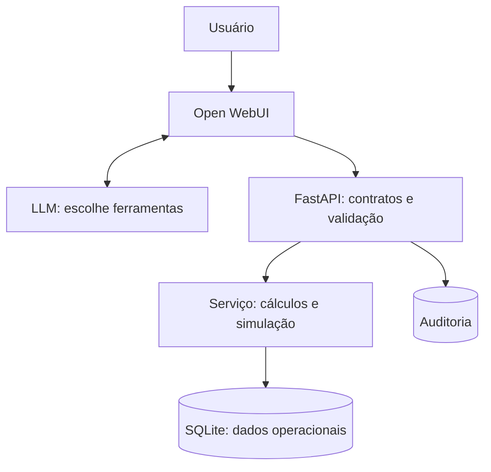

# Agente de IA para balanço de massa
Protótipo acadêmico de Alef Henrique de Souza Nascimento. Apenas dados fictícios.

## Executar no Linux com Docker
Pré-requisitos: Docker Engine com Compose plugin, acesso ao daemon e internet para baixar imagens/pacotes. Docker reduz diferenças de ambiente; não elimina falhas de rede, arquitetura, permissões ou portas ocupadas.

```bash
docker compose up --build -d
```
API: http://localhost:8000/docs

```bash
curl http://localhost:8000/ordens/21579001/balanco
curl http://localhost:8000/ordens/21579001/simulacao
docker compose run --rm api python -m unittest discover -s tests -v
```
Para chat:
```bash
docker compose --profile chat up --build -d
```
Open WebUI: http://localhost:3000. Configure modelo e servidor de ferramentas conforme [docs/agente.md](docs/agente.md). A API sozinha é o núcleo determinístico; a execução agêntica depende do modelo e configuração do chat. Nenhuma credencial está incluída. Imagem Open WebUI fixada em v0.6.34 para reprodução; não é alegação de versão mais recente. Dependências diretas fixadas; transitivas e imagem base não estão fixadas por hash.

## Dados SQLite
`sql/schema.sql`: tabelas materiais, conversões, ordens, tipos de movimento, movimentos e auditoria. `sql/seed.sql`: oito ordens, quatro materiais e 48 movimentos, com os seis tipos. `data/balanco.sqlite3`: cópia inicial inspecionável, incluída no ZIP. No Docker o banco é criado pelo SQL em um volume novo; dados não são carregados do Python. Inicialização não duplica a carga.

Ordens: oito dígitos; materiais: 12 dígitos. Prefixos e movimentos seguem a convenção solicitada para este trabalho, sem pretensão de reproduzir integralmente SAP. Valores numéricos são TEXT decimal e calculados com Decimal, evitando ponto flutuante no balanço. Conversões por material e unidade. Chaves estrangeiras habilitadas.

Competência de demonstração fixa em 2026-11 no compose, para os testes continuarem reproduzíveis. A regra de encerramento usa competência de referência da ordem como aproximação do mês; em uso real definir qual data de negócio prevalece.

## Regras
Consulte [docs/regras.md](docs/regras.md). Não há módulos de logística, HU ou PI Review nesta entrega. A simulação não altera movimentos: auditoria registra a consulta. Realocação simula estorno e consumo, mas não cria documentos SAP.

## Arquitetura

Contrato OpenAPI gerado em `/openapi.json`. IDs: listar_ordens, consultar_regras, consultar_balanco, simular_realocacao. Decisões do modelo: quais consultas executar e como comunicar resultados; regras de massa e elegibilidade pertencem ao serviço. Ferramentas aceitam apenas ordens locais de oito dígitos; sem SQL livre nem escrita operacional exposta. Sem autenticação corporativa; portas publicadas apenas no loopback para demonstração local.

## Testes, evals e evidências
10 testes automatizados em tests/test_balanco.py: estornos, conversões, tolerância, realocação múltipla, material, elegibilidade, zero, inexistência, não mutação e seed idempotente. Resultado da execução local em docs/testes.txt. Testes HTTP exercitados separadamente e registrados em docs/verificacao.txt. Plano de evals e demonstração em [docs/demo.md](docs/demo.md). Auditoria em SQLite armazena respostas bem-sucedidas; erros HTTP aparecem no log do servidor, não na tabela. Falhas de modelo são avaliadas no chat.

## Limitações
Heurística gulosa, não otimizador global. Ordens doadoras/receptoras candidatas terminam balanceadas; alvo pode permanecer parcial. Toda a base é validada ao carregar; registro inválido pode interromper análise de outra ordem. Sem histórico temporal completo de apontamentos/cancelamento de documento específico. Sem execução de reabertura ou estorno. Limites do LLM descritos em prompt não substituem limites programáticos. Não foi executado Docker neste ambiente de geração; validar build e chat no computador Linux. Sem vídeo final gravado nem evals com LLM executadas.

## Encerrar e persistência
```bash
docker compose --profile chat down
```
Preserva os volumes. `down -v` APAGA bancos e contas: não usar para encerrar normalmente.

## Repositório e entrega
Pasta organizada e histórico Git local incluído no pacote. Publicar em um repositório remoto ainda requer escolher conta/destino. Não incluir chaves. Entregáveis: fonte, README, diagrama Mermaid, testes, plano de evals e roteiro de demonstração. Gravar o vídeo após validar no Linux e configurar o modelo.

## Referências
https://fastapi.tiangolo.com/deployment/docker/
https://docs.openwebui.com/features/extensibility/plugin/tools/openapi-servers/open-webui/
https://docs.openwebui.com/getting-started/quick-start/
